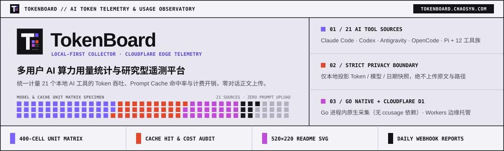
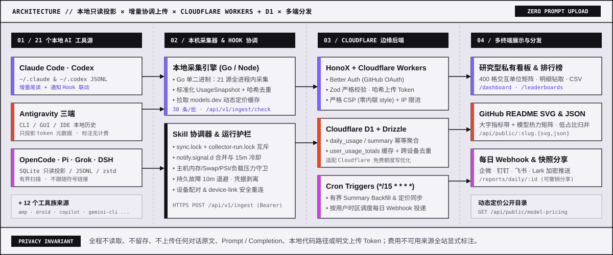
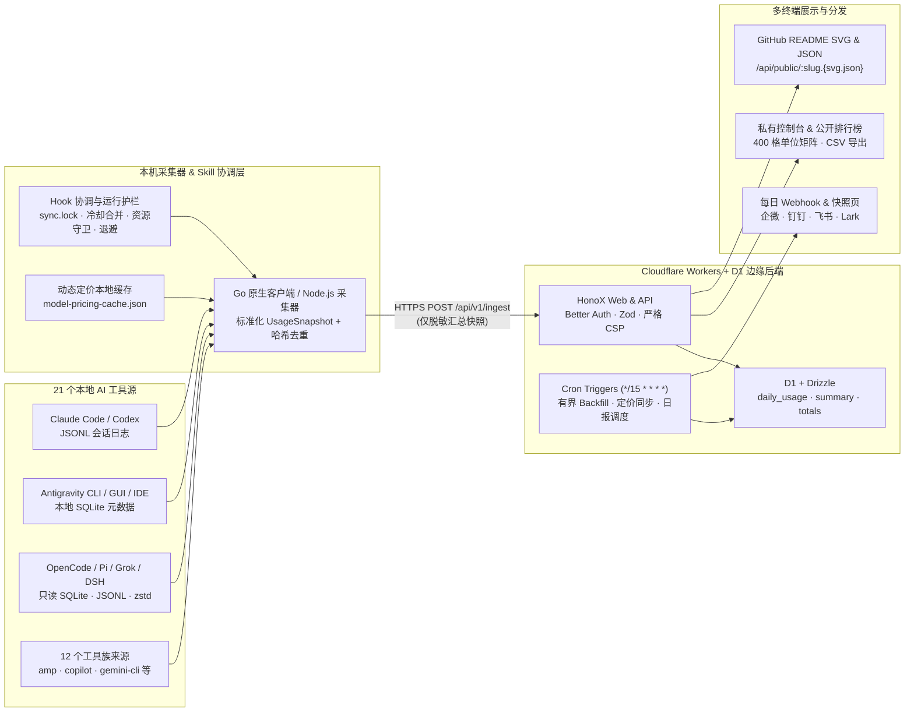

<div align="center">

<a href="https://tokenboard.chaosyn.com/">
  
</a>

<br />

 &nbsp; **TokenBoard** — 多用户 AI 算力用量统计与研究型遥测平台 · Multi-User AI Token Telemetry Observatory

[](https://tokenboard.chaosyn.com/)
[](#21-个工具源适配矩阵)
[](#架构与原理)
[](#版本与结构)
[](#本机采集机制与隐私护栏)
[](#隐私与安全护栏)

统一采集 **Claude Code、Codex、Antigravity、OpenCode、Pi、Grok Build、DeepSeek Harness** 等 **21 个本地 AI 编程工具**的 Token 吞吐、Prompt Cache 命中率与计费开销；边缘托管于 Cloudflare Workers + D1，提供研究型私有看板、公开排行榜、每日 Webhook 报告与可嵌入的 GitHub README SVG 卡片。

[在线体验](https://tokenboard.chaosyn.com/) · [核心特性](#核心特性) · [架构与原理](#架构与原理) · [21 工具源矩阵](#21-个工具源适配矩阵) · [快速开始](#快速开始) · [README SVG 卡片](#公开展示与-github-readme-svg-卡片) · [每日 Webhook 报告](#每日-webhook-报告) · [采集与隐私护栏](#本机采集机制与隐私护栏) · [开发与部署](#本地开发与生产部署)

</div>

---

## 为什么需要 TokenBoard？

在多 Agent 协同编码的日常工作流中，开发者往往同时在多台设备、多个本地 AI 编程工具之间切换，算力与成本观测随之面临三个常见痛点：

- **算力数据割裂**：Claude Code、Codex、Antigravity、OpenCode、Pi、Copilot 等工具各自将日志存放在不同的 JSONL、SQLite 或压缩文件中，无法一眼看清个人全周期与当月的真实消耗分布。
- **仅看总 Token 容易失真**：多轮 Agent 会话里 Prompt Cache 读取占比往往高达 80%–95%+；不区分「总 Tokens / 不含缓存读 / 缓存命中率」，就无法判断真实的新增上下文成本；同时部分工具并不提供官方计费，强行用定价表推算反而会产生失真账单。
- **隐私与维护负担**：直接上传原始对话日志存在代码与密钥泄漏风险，而自建重型统计服务又带来高昂的运维与数据库成本。

**TokenBoard 的解法**：在用户本机通过轻量采集器（Go 单二进制原生采集或 Node.js 采集器）**只读取并投影脱敏后的每日聚合指标**（Token / 模型 / 日期 / 会话数），绝不读取或上传任何对话正文、代码路径或明文 Token；托管端基于 **HonoX + Cloudflare Workers + D1** 运行，开箱提供研究型遥测看板、公开排行榜、每日机器人日报以及可嵌入 GitHub README 的矢量卡片。

---

## 核心特性

- **21 个本地 AI 工具源统一计量（支持 Go 进程内原生采集）**
  - 原生覆盖 **9 个核心工具源**（Claude Code、Codex、Antigravity CLI / GUI / IDE、OpenCode、Pi、Grok Build、DeepSeek Harness）与 **12 个工具族来源**（`amp`、`droid`、`codebuff`、`hermes`、`goose`、`kilo`、`copilot`、`gemini-cli`、`kimi`、`qwen`、`openclaw`、`zcode`）。
  - Go 客户端（`clientType: binary`）在进程内直接读取全部 21 个来源，**不下载、不执行、不分发 `ccusage`**；同时保持默认 `clientType: git` Node.js 采集器的完整兼容。

- **全口径算力审计与透明计费原则**
  - 全站看板、明细、排行榜、公开 JSON、日报与 SVG 卡片统一呈现 **总 Tokens、不含缓存读、Prompt Cache 命中率与复用倍率**。
  - 动态模型定价目录从 `https://models.dev/api.json` 定时同步至 D1 并通过 `/api/public/model-pricing` 分发；对于不提供官方费用的来源（Antigravity 三端、Grok Build、DeepSeek Harness），全站显式标注「**费用不可用**」，绝不以 `$0.00` 混淆完整账单或用 credits 虚构推算。

- **研究型数据可视化与公开展示**
  - **私有控制台与排行榜**：400 格交互单位矩阵图（支持按模型、工具源、Token 类型动态重组）、多维度明细钻取、CSV 导出、每日/每月公开排行榜。
  - **520×220 GitHub README SVG 卡片**：固定矢量规格、零内联 `style`（严格 CSP 兼容）；上方为「大字数字 + 细线描述」指标带，下方嵌入 48 列**热力图式模型单元矩阵**，占比低于 5% 或超出主力梯队的长尾模型自动归并为「**其他 N 个模型**」，支持浅深双主题、三种版式、中英文与自定义指标排序。

- **多平台加密 Webhook 日报与可撤销分享页**
  - 原生支持 **企业微信（WeCom）、钉钉（DingTalk）、飞书（Feishu）、Lark** 四个机器人平台，Webhook 地址与签名密钥均以 32 字节密钥加密存储在 D1 中。
  - 支持按用户时区与星期配置每日最多 4 个推送时段，附带仅含聚合快照的公开日报分享页（支持全局开关、单条撤销与保留期控制）。

- **面向 Cloudflare 免费额度与低侵入本机运行优化**
  - 新采集器按 30 条/批分片上传，结合 `/api/v1/ingest/check` 跳过未变化快照；后端提供 D1 汇总缓存（`user_usage_totals`、`daily_usage_summary`）与有界 cron backfill。
  - 本机 Hook 采用信号合并、15 分钟冷却、临近定时任务跳过、**主机资源压力守卫**（内存 / Swap / Linux PSI / 负载）与持久故障 10 分钟退避，绝不拖慢日常开发机器。

---

## 架构与原理



<details>
<summary>查看 Mermaid 文本版架构图</summary>



</details>

---

## 21 个工具源适配矩阵

### 核心来源（9 项）

| 来源标识 (`source`) | 本地读取位置与环境变量覆盖 | 费用口径 | Notifier Hook |
| --- | --- | --- | --- |
| `claude-code` | `~/.claude/projects/**/*.jsonl`（`CLAUDE_CONFIG_DIR`、`CLAUDE_HOME`） | 支持计费（含动态定价） | `~/.claude/settings.json` `hooks.SessionEnd` |
| `codex` | `~/.codex/{sessions,archived_sessions}/**/*.jsonl`（`CODEX_HOME`、`TOKENBOARD_CODEX_HOMES_JSON`） | 支持计费（含动态定价） | `~/.codex/config.toml` `notify` |
| `antigravity-cli` | `~/.gemini/antigravity-cli/conversations/*.db` token 元数据 | 费用不可用（固定 `0` 并显式标注） | `~/.gemini/antigravity-cli/settings.json` `statusLine.command`（仅显式 opt-in 写本地诊断日志，不参与上传） |
| `antigravity` | `~/.gemini/antigravity/conversations` token 元数据 | 费用不可用（固定 `0` 并显式标注） | 无（定时 / 手动同步） |
| `antigravity-ide` | `~/.gemini/antigravity-ide/conversations` token 元数据 | 费用不可用（固定 `0` 并显式标注） | 无（定时 / 手动同步） |
| `opencode` | `~/.local/share/opencode/opencode.db`（支持 `XDG_DATA_HOME`；SQL 内 `json_extract` 只读投影） | 自报费用 | 无 |
| `pi` | `~/.pi/agent/sessions/**/*.jsonl`（`PI_CODING_AGENT_DIR`、`PI_CODING_AGENT_SESSION_DIR`） | 自报费用 | 无 |
| `grok-build` | `~/.grok/{sessions,archived_sessions}/**/updates.jsonl`（`GROK_HOME`） | 费用不可用（固定 `0` 并显式标注） | 无 |
| `deepseek-harness` | `~/.dsh/sessions/**/session.jsonl[.zstd]`（`DSH_HOME`、`DSH_SESSION_ROOT`） | 费用不可用（固定 `0` 并显式标注） | 无 |

### 工具族来源（12 项）

`amp` · `droid` · `codebuff` · `hermes` · `goose` · `kilo` · `copilot` · `gemini-cli` · `kimi` · `qwen` · `openclaw` · `zcode`

- Go 客户端（`clientType: binary`）在进程内复刻 `ccusage 20.0.33` 的读取与计价逻辑并逐行与冻结基线对齐；Node.js 采集器（`clientType: git`）过渡期仍通过统一参数化调用读取。
- 未安装的工具在 `--source all` 运行时自动跳过，不视为错误；真正的文件/数据库读取异常会明确报错而非静默丢数据。
- 工具族来源不安装 Hook，且不支持 `--until` 窗口参数。

---

## 快速开始

### 1. 网页端配对并安装本机采集器（推荐）

打开已部署的 TokenBoard 实例（例如 [tokenboard.chaosyn.com](https://tokenboard.chaosyn.com/)），使用 GitHub 登录后进入安装向导：

```txt
https://tokenboard.chaosyn.com/settings/install
```

1. 选择设备名称与客户端类型（默认 Node.js `git` 检出，或选用无包管理器依赖的 Go 单二进制 `binary`）。
2. 复制页面生成的安装提示词，粘贴到 **Codex** 或 **Claude Code** 中由 Agent 自动执行。
3. 安装脚本会自动完成设备配对、写入 `~/.tokenboard/config.json` 与本机恢复凭证 `~/.tokenboard/device-link.json`、注册定时任务与通知 Hook，并执行首次同步（可加 `--skip-initial-sync` 跳过首次同步）。

> 安装表单会自动读取浏览器 `Intl.DateTimeFormat().resolvedOptions().timeZone` 写入 IANA 时区，仅当浏览器无法提供有效时区时才回退 `UTC`。

### 2. 本机常用运维命令

```bash
# 查看本机采集器、设备身份、Hook、计划任务与最近同步状态（输出自动脱敏）
node skills/tokenboard/scripts/status.mjs

# 手动触发全来源同步（默认回看本地 7 天；--since 支持 YYYYMMDD / YYYY-MM-DD / all）
node skills/tokenboard/scripts/sync.mjs --mode sync --source all --package-manager pnpm

# 卸载计划任务与 Hook（按需保留或清理配置与状态）
node skills/tokenboard/scripts/uninstall.mjs
node skills/tokenboard/scripts/uninstall.mjs --remove-config
node skills/tokenboard/scripts/uninstall.mjs --all
```

TypeScript 检出采集器可通过 `TOKENBOARD_PACKAGE_MANAGER` 覆盖包管理器（可选 `pnpm`、`bun`、`npm`）；Go 单二进制客户端安装与采集均不依赖任何包管理器。

---

## 公开展示与 GitHub README SVG 卡片

用户资料**默认私有**。登录后前往 `/settings/profile` 开启公开分享与排行榜参与，即可获取两个公开接口：

```txt
GET /api/public/:slug.json
GET /api/public/:slug.svg
```

将下方 Markdown 粘贴到你的 GitHub Profile 或项目 README 中即可实时展示：

```md
[](https://tokenboard.chaosyn.com/)
```

### 卡片能力亮点

- **固定 `520×220` 矢量规格与严格 CSP 兼容**：零内联 `style=` 属性，直接适配 GitHub Camo 代理与深浅双主题渲染。
- **大字数字 + 热力图式模型矩阵**：
  - 上半区采用大字数值优先的细线指标带（百万以上自动压缩为 `1.55B` / `482.9M`，下方紧跟指标名称与缓存倍率/当月开销等辅助说明）；
  - 下半区嵌入 48 列热力图式模型单元矩阵，占比低于 **5%** 或超出前 4 个主力模型的长尾模型自动归并为「**其他 N 个模型**」（英文卡片显示 `Other N models`）；若暂无模型分布则自动退化为同构的 Prompt Cache 复用热力矩阵。
- **完整可视化定制**：支持中英文、浅/深主题、三种版式（均衡四格 / 宽幅三列 / 紧凑六格）、自定义标题与副标题、指标排序与隐藏、右上角可选更新时间与「今日」时区标注、实时私有预览及一键恢复默认（损坏配置自动安全回退，不会破坏设置页）。

---

## 每日 Webhook 报告

登录用户可在 `/settings/notifications` 添加每日定时推送机器人，支持配置服务商、加密 Webhook URL、可选签名密钥、时区、推送星期以及每日最多 **4 个本地发送时段**（默认 `18:00`）。

启用前请先为 Worker 写入 32 字节 Base64 加密密钥：

```bash
openssl rand -base64 32
pnpm --filter @tokenboard/web exec wrangler secret put WEBHOOK_ENCRYPTION_KEY
```

### 支持平台与投递形态

| 平台 | 允许的 Webhook Host | 消息形态 | 跳转按钮 / CTA 行为 |
| --- | --- | --- | --- |
| **企业微信 (WeCom)** | `https://qyapi.weixin.qq.com/cgi-bin/webhook/send?...` | 按企微字节上限裁剪的 Markdown | 内联日报快照链接，未开启分享时回退排行榜链接 |
| **钉钉 (DingTalk)** | `https://oapi.dingtalk.com/robot/send?...` | 支持加签的 `actionCard`，保留 `TokenBoard` 关键词以兼容关键词校验机器人 | `singleTitle` / `singleURL` 按钮，并在裁剪区外保留内联兜底链接 |
| **飞书 (Feishu)** | `https://open.feishu.cn/open-apis/bot/v2/hook/...` | 飞书交互卡片 2.0（支持可选签名校验） | 卡片按钮 `open_url`，优先打开日报详情页，回退排行榜 |
| **Lark** | `https://open.larksuite.com/open-apis/bot/v2/hook/...` | 交互卡片 2.0（支持可选签名校验） | 同飞书，优先日报详情页，回退排行榜 |

### 去重、重试与快照分享权限

- 推送内容包含总 Tokens、不含缓存读、缓存命中率、计费开销、会话数、来源占比、Top 模型及日报快照链接；手动测试推送会显式标注为预览。
- 定时发送按「订阅 × 报告日期 × 时间槽」幂等去重，失败最多重试 3 次；Cron 时间以 UTC 触发，用户推送时间按各自订阅时区实时换算。
- 日报历史仅保存聚合快照，不存原始明细。用户可在 `/settings/notifications` 一键关闭全局匿名访问或撤销单条分享链接；匿名访问 `/reports/daily/:id` 需同时满足全局开启、链接未撤销且在保留窗口内（默认 30 天，由 `TOKENBOARD_DAILY_REPORT_HISTORY_DAYS` 控制）。

---

## 本机采集机制与隐私护栏

### 隐私与安全护栏

- **严格零正文上传**：所有本地读取器仅提取 `token`、`model`、`timestamp`、去重哈希与会话数；绝不读取或上传任何对话正文、Prompt/Completion、工具参数、本地路径、邮箱或明文上传 Token。
- **最小读取面**：OpenCode 通过只读方式打开 SQLite 并在 SQL 内部使用 `json_extract` 投影字段，完整消息 blob 从不进入采集器进程；SQLite 优先使用 Node 内置 `node:sqlite`，缺失时回退 `sqlite3`（可用 `TOKENBOARD_SQLITE_BIN` 显式指定）。目录扫描严格限制深度、不跟随符号链接并跳过超限文件。
- **子进程凭据剥离**：调用第三方工具或升级脚本前自动剔除 `TOKENBOARD_UPLOAD_TOKEN`、`TOKENBOARD_PAIRING_CODE` 等敏感环境变量；上传请求强制 HTTPS（仅 loopback 放行）且禁止自动跟随重定向。
- **敏感设备凭据保护**：`~/.tokenboard/device-link.json` 为本机敏感恢复凭据，安装流程永不打印 claim，设备重连必须显式传入 `--use-device-link`；历史无 `device_id` 的旧 Token 归入 `legacy` 设备并在汇总视图中自动去重。

### 增量同步、冷却与防抖策略

- **时间窗与分片**：定时与手动同步默认回看本地 7 天；`--since all` 触发显式全量历史回填；Hook 模式仅增量尾读 Claude Code / Codex 追加写入的 JSONL 后缀并按变更日期对账（文件截断、替换或游标缺失时自动回退全文件扫描）。
- **批大小与变更检测**：新采集器每批最多上传 30 条快照，并通过 `POST /api/v1/ingest/check` 跳过未变动记录；服务端仍向后兼容旧版 500 条批量请求并在内部自动分片落库。
- **Hook 合并与冷却**：各来源信号原子写入 `~/.tokenboard/notify.signal.d` 合并去重，与定时/手动任务共用 `sync.lock`；运行期间收到的信号在默认 15 分钟冷却后合并为单次尾随同步（`TOKENBOARD_NOTIFY_COOLDOWN_MS` 可设 `60000`–`7200000`）。距离下一次定时同步不足 30 分钟的 Hook 触发会自动跳过。
- **主机资源压力守卫**：当主机剩余内存 `< 10%`、Swap 已用 `>= 90%`、Linux I/O PSI `>= 60` 或单核负载 `> 2` 时，自动跳过本次 Hook 扫描并保留信号交由定时任务采集（可通过 `TOKENBOARD_RESOURCE_MEMORY_FREE_MIN_PERCENT`、`TOKENBOARD_RESOURCE_SWAP_USED_MAX_PERCENT`、`TOKENBOARD_RESOURCE_IO_AVG10_MAX` 调整，或设 `TOKENBOARD_RESOURCE_GUARD=off` 关闭；无法读取的指标绝不误拦截）。
- **持久故障退避与定时重试**：Hook 因不可达端点或 provider 错误失败后进入默认 10 分钟退避（`TOKENBOARD_NOTIFY_FAILURE_BACKOFF_MS` 或配置项 `notifyFailureBackoffMs`，支持 `60000`–`7200000` 或 `0` 关闭），纯锁竞争不触发退避且维持 1 分钟重试；定时任务遇锁超时最多在进程内间隔 1 分钟重试 5 次。
- **多配置路径与日志轮转**：Codex 多配置目录路径包含逗号时使用 `TOKENBOARD_CODEX_HOMES_JSON` JSON 数组替代 `CODEX_HOME`；日志文件位于 `~/.tokenboard/logs/daily-sync.{out,err}.log`，单文件上限 1 MiB、保留 7 天。

---

## 本地开发与生产部署

### 版本与结构

```text
TokenBoard/
├── apps/web/               # HonoX + Cloudflare Workers Web 看板、API、SVG 卡片与 D1 Migrations
├── packages/usage-core/    # 跨端共享的 21 来源枚举、UsageSnapshot Schema、哈希与标准化逻辑
├── packages/collector/     # 本地 Node.js 采集器（clientType: git 默认路径）
├── clients/go/             # Go 原生客户端（21 源全进程内采集、动态定价、自更新与 shadow 对拍）
├── skills/tokenboard/      # Codex / Claude Code 安装、同步、Hook 协调、压力守卫与定时任务脚本
├── scripts/                # 跨端契约与定价金样本生成脚本
└── docs/                   # 架构设计、Go 客户端规格、动态定价文档与生产演练记录
```

### 运行环境要求与本地测试

要求 Node.js **`^22.23.4 || ^24.22.1 || >=26.12.1`**（`.npmrc` 已开启 `engine-strict=true`，低于该范围的版本缺少 CVE-2026-111497 及 TLS 主机名校验修复，会在安装阶段直接拦截）。

```bash
# 安装依赖与本地开发
pnpm install
pnpm dev

# 全仓测试、类型检查与构建
pnpm test
pnpm typecheck
pnpm build

# 运行 Skill 协调脚本测试（Ubuntu / Windows 跨平台覆盖）
node --test skills/tokenboard/scripts/*.test.mjs

# 运行 Go 客户端全量竞态测试
cd clients/go && go test ./... -race
```

### 生产部署（Cloudflare Workers + D1）

复制模板 `apps/web/wrangler.production.example.jsonc` 为本地忽略文件 `apps/web/wrangler.production.jsonc`，填写自定义域名路由、规范 `BETTER_AUTH_URL` 与 D1 数据库 UUID 后，使用仓库内置的守卫脚本手动发布：

```bash
pnpm run deploy
# 或直接指定 Web workspace：
pnpm --filter @tokenboard/web run deploy
```

> **注意**：必须执行 `pnpm run deploy`（直接写 `pnpm deploy` 会被 pnpm 内置命令拦截）。当存在未应用的 D1 migration 时，**严禁直接运行裸 `wrangler deploy`**；仓库刻意未启用 Cloudflare Workers Builds 或 GitHub Actions 自动部署，以保证每次上线均按「配置校验 → 构建 → 执行远端 D1 Migration → 校验关键表结构 → 发布 Worker」的严格顺序推进。

#### 必需的 Worker Secrets

| Secret | 用途 |
| --- | --- |
| `BETTER_AUTH_SECRET` | Better Auth 会话签名密钥 |
| `GITHUB_CLIENT_ID` | GitHub OAuth 应用 Client ID |
| `GITHUB_CLIENT_SECRET` | GitHub OAuth 应用 Client Secret |
| `WEBHOOK_ENCRYPTION_KEY` | 32 字节 Base64 Webhook URL 加密密钥 |

#### 手动部署环境变量

| 变量 | 用途 |
| --- | --- |
| `CLOUDFLARE_ACCOUNT_ID` | Cloudflare 账号 ID |
| `CLOUDFLARE_API_TOKEN` | 具备 D1 编辑与 Worker 发布权限的 API Token |
| `D1_DATABASE_ID` | 生产环境 D1 数据库 UUID |

#### 部署配置变量（`wrangler.production.jsonc`）

| 变量 | 默认值 | 说明 |
| --- | ---: | --- |
| `TOKENBOARD_WORKER_ROUTE` | 必填 | 生产自定义域名主机名 |
| `BETTER_AUTH_URL` | 必填 | 规范 `https://...` 站点源地址 |
| `TOKENBOARD_COLLECTOR_REPO_URL` | 必填 | 安装提示词中引用的 GitHub 仓库地址 |
| `TOKENBOARD_COLLECTOR_REF` | 必填 | 安装提示词中引用的分支 / Ref |
| `TOKENBOARD_DAILY_REPORT_HISTORY_DAYS` | `30` | 日报快照保留天数（`1`–`31`） |
| `TOKENBOARD_WEBHOOK_LOG_RETENTION_DAYS` | `90` | Webhook 投递日志保留天数（`1`–`365`） |
| `TOKENBOARD_WEBHOOK_CRON_BATCH_SIZE` | `5` | 每次 Cron 最多投递条数（`1`–`50`） |
| `TOKENBOARD_USAGE_SUMMARY_BACKFILL_LIMIT` | `50` | 每次 Cron 最多回填的 summary key 数（`1`–`500`） |
| `TOKENBOARD_USAGE_SUMMARY_STRICT` | `false` | 仅在历史 summary 回填完成后设为 `true` |
| `TOKENBOARD_MODEL_PRICING_SYNC_ENABLED` | `true` | 是否启用每日 `models.dev` 定价同步至 D1 |
| `TOKENBOARD_MODEL_PRICING_SYNC_INTERVAL_HOURS` | `24` | 定时定价同步间隔小时数（`1`–`168`） |
| `TOKENBOARD_MODEL_PRICING_SOURCE_URL` | `https://models.dev/api.json` | 模型定价目录源地址，详见 [动态模型定价说明](docs/model-pricing.md) |

生产配置校验同时要求：`workers_dev: false`、HTTPS 协议的 `BETTER_AUTH_URL`、合法生产路由与 D1 UUID、显式 `TOKENBOARD_COLLECTOR_REPO_URL` / `TOKENBOARD_COLLECTOR_REF`、`*/15 * * * *` 通知 Cron 触发器以及合法数值范围的保留/批处理参数。如遇未先执行 D1 migration 就误发布导致的故障，请参照 [生产恢复演练手册](docs/reviews/UPSTREAM-PRODUCTION-RECOVERY-2026-07-16.md) 处置。

---

## 延伸阅读

- [动态模型定价目录与缓存机制](docs/model-pricing.md)
- [Go 客户端架构与跨端协议规格](docs/specs/go-client-spec.md)
- [设备身份配对与安全重连设计](docs/architecture/device-identity-reconnect-plan.md)
- [生产环境 D1 迁移故障恢复手册](docs/reviews/UPSTREAM-PRODUCTION-RECOVERY-2026-07-16.md)
- [仓库架构与贡献者指南 (AGENTS.md)](AGENTS.md)

## 参与贡献

欢迎通过 Issue 或 Pull Request 参与改进：

1. Fork 本仓库并创建特性分支（`git checkout -b feat/your-feature`）。
2. 提交前请确保改动范围对应的单测与类型检查全部通过（`pnpm typecheck && pnpm test`；涉及 Go 客户端请额外运行 `cd clients/go && go test ./... -race`）。
3. 在 PR 说明中附上改动范围、验证命令及界面/Webhook 实机验证截图。
